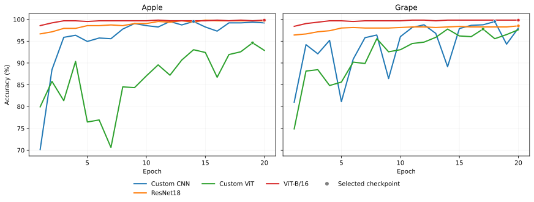
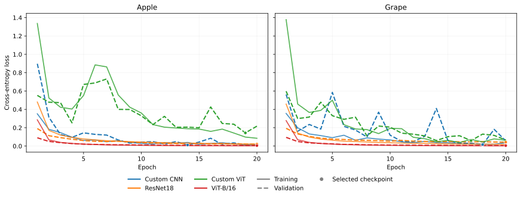

# Leaffliction

An image-processing and machine-learning pipeline for plant-disease classification from leaf images, built in Python and PyTorch.

The project follows the [Leaffliction project subject](leaffliction.pdf),
which structures the work into four parts: dataset analysis, augmentation,
image transformation, and classification.

Some implementation details reflect the project's submission and evaluation 
requirements (e.g., the creation of a balanced dataset output in `augmented_directory/`).

### 1. Dataset analysis

Inspect class distributions and visualise image counts to identify imbalanced datasets.

### 2. Augmentation

Apply geometric transformations and distortions, and generate additional images to balance underrepresented classes.

### 3. Image transformation

Segment leaves and visualise contours, landmarks, shape measurements, and colour distributions.

### 4. Classification

Train and evaluate four image classifiers: a custom CNN, pretrained ResNet18,
a custom Vision Transformer, and pretrained ViT-B/16. Custom models are trained
from scratch; pretrained models use frozen ImageNet backbones with trainable
classification heads.

The pipeline splits original images before augmenting the training set, records
splits in CSV manifests, and keeps experiment outputs separate. Custom models
use normalisation statistics computed from training data; pretrained models
use preprocessing associated with their ImageNet weights.

Each classifier derives its output count from the dataset's class directories.
Apple and Grape are trained separately, with four classes each.

See [DESIGN.md](DESIGN.md) for implementation decisions and tradeoffs.

#### Model performance

The figure below shows validation accuracy over 20 epochs, with markers indicating the checkpoints selected by minimum validation loss.



All four models achieved over 94% validation accuracy at their selected checkpoints. Both pretrained models converged quickly and maintained consistently high accuracy, with ViT-B/16 achieving the highest accuracy on both datasets (99.84%). Among the models trained from scratch, the custom CNN reached high accuracy relatively quickly, while the custom ViT improved more gradually and showed greater fluctuations throughout training.

These results are from individual training runs on the validation datasets, rather than an independent test set.

## Project structure

The root-level scripts provide the command-line entry points required by the
project subject, while the implementation is organised into modules by stage:

- `analysis/` — dataset distribution analysis and visualisation
- `augmentation/` — image augmentation and dataset balancing
- `transformation/` — leaf segmentation and feature visualisation
- `classification/` — data loading, model definitions, training utilities, and preprocessing
- `manifests/` — CSV files recording dataset splits
- `demo_images/` — example images for running inference
- `visualisations/` — training-history plots and the script used to generate them

Dataset balancing creates a balanced copy in `augmented_directory/` and saves
generated augmentations alongside source images. Classification generates
training augmentations alongside source images and stores model checkpoints
in `checkpoints/`. Generated images and checkpoints are not tracked by Git.

## Setup

This project uses **Python 3.10**. Create and activate a virtual environment:

On macOS or Linux:

```bash
python3.10 -m venv .venv
source .venv/bin/activate
```

On Windows (PowerShell):

```powershell
py -3.10 -m venv .venv
.\.venv\Scripts\Activate.ps1
```

### Install dependencies

```bash
python -m pip install -r requirements.txt
```

For development, install the runtime dependencies and Flake8 together:

```bash
python -m pip install -r requirements-dev.txt
```


### GPU acceleration

The standard setup is sufficient to run the project on CPU. Training and prediction automatically use CUDA when it is available, and otherwise use the CPU.

The tested Windows configuration uses PyTorch 2.6.0, torchvision 0.21.0, and CUDA 12.6. After installing the dependencies above, replace the PyTorch packages with their CUDA 12.6 builds:

```bash
python -m pip install --force-reinstall --no-deps torch==2.6.0 torchvision==0.21.0 --index-url https://download.pytorch.org/whl/cu126
```

This procedure was tested on Windows; other platforms may require different installation steps.

Verify that PyTorch detects your GPU:

```bash
python -c "import torch; print(torch.cuda.is_available())"
```

A result of `True` indicates that CUDA is available to PyTorch.


## Usage

### Analyse a dataset

Visualise the class distribution for a plant dataset:

```bash
python Distribution.py data/Apple
```

### Preview augmentations

Apply and visualise the available augmentation techniques on a single image:

```bash
python Augmentation.py "data/Apple/Apple_Black_rot/image (1).JPG"
```

### Balance a dataset

Generate augmented images for underrepresented classes:

```bash
python Augmentation.py data/Apple
```

The balanced dataset is written to `augmented_directory/`.

### Apply Transformations 

Display all transformations for one image

```bash
python Transformation.py 'data/Apple/Apple_Black_rot/image (1).JPG'
```

Save all transformations from a directory
```bash
python Transformation.py 'demo_images' --dst transformation_outputs
```


### Train a classifier

Choose a model using `--model`:

| `--model` | Architecture | Trainable parameters |
| --- | --- | --- |
| `custom_cnn` | Custom CNN | Entire model |
| `pretrained_cnn` | ResNet18 | Classification head |
| `custom_vit` | Custom ViT | Entire model |
| `pretrained_vit` | ViT-B/16 | Classification head |

Train a classifier for Apple or Grape:

```bash
python train.py data/Apple --model custom_cnn --run-name baseline_apple
python train.py data/Grape --model custom_cnn --run-name baseline_grape
```

Outputs are saved under `checkpoints/<model>/<run-name>/`. Each completed run
produces `best.pt`, selected by lowest validation loss, `last.pt`, and
`history.json`. Existing run directories cannot be reused.

Training defaults to pretrained ResNet18, 20 epochs, batch size 32, and learning
rate 0.001. Use `--epochs`, `--batch-size`, and `--learning-rate` to override
these values.

Pretrained weights are downloaded on first use unless already cached.


<details>
<summary>Training and validation loss curves</summary>

The following figure shows training and validation loss across
20 epochs for all four models on the Apple and Grape datasets.
Markers indicate the checkpoints selected by minimum validation loss.



</details>


### Predict an image label

Run inference using a checkpoint produced by `train.py`:

```bash
python predict.py demo_images/predict_apple_black_rot.JPG --checkpoint checkpoints/pretrained_cnn/baseline_apple/best.pt
python predict.py demo_images/predict_grape_black_rot.JPG --checkpoint checkpoints/pretrained_cnn/baseline_grape/best.pt
```

Prediction restores the architecture, class mapping, preprocessing, and weights
from the checkpoint. It displays the original image, preprocessed image,
predicted class, and Grad-CAM overlay. Custom ViT also displays attention rollout.

### Restore the dataset

Restore the dataset by removing generated augmentations, its classification
manifest, and generated split symlinks:

```bash
python Restore.py data/Apple
```

To prepare for evaluation while preserving the manifest and balanced dataset
in `augmented_directory/`, use:

```bash
python Restore.py data/Apple --evaluation
```
